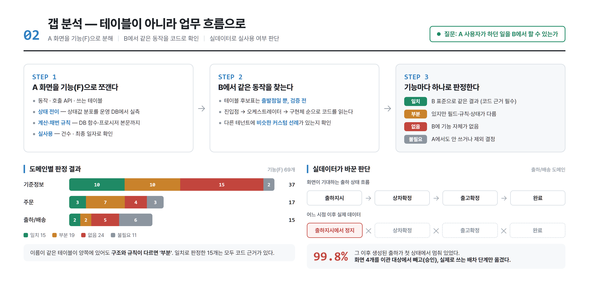

> **이 글의 핵심**: 테이블 이름을 비교하지 않고 "A 사용자가 하던 일을 B에서도 할 수 있는가"를 기준으로 기능 69개를 판정했다. 그대로 일치하는 기능은 15개뿐이었고, 실데이터를 근거로 **쓰지 않는 화면 4개를 이관 전에 걸러냈다.**
{: .prompt-info }

- (1) [다른 서비스를 SaaS 테넌트로 옮기는 5단계 워크플로](/posts/service-migration-workflow/)
- (2) 테이블 이름이 아니라 업무 흐름으로 갭 찾기 ← 이 글
- (3) [공통 코드를 건드리지 않는 테넌트 커스텀 등급](/posts/service-migration-tenant-custom/)
- (4) [구조가 다른 데이터 모델 매핑과 리허설](/posts/service-migration-data-mapping/)
- (5) [앞 단계가 틀렸다고 가정하고 검증하기](/posts/service-migration-verification/)

이 글은 5단계 중 **1단계, 갭 분석**이다. 기존 시스템(A)에 있는 기능이 옮겨 갈 플랫폼(B)에도 있는지, 있다면 똑같이 동작하는지를 판정한다.

## 질문을 바꾼다

갭 분석을 테이블 비교로 시작하면 질문이 "A의 이 테이블이 B에 있는가"가 된다. 에이전트는 이 질문에 아주 빨리 답한다. 이름이 비슷한 테이블을 찾아 짝을 지으면 되기 때문이다.

하지만 이관이 실패하는 지점은 테이블이 아니라 **업무**다. 테이블은 다 옮겼는데 주문 화면에서 품목이 안 보이거나, 단가가 다르게 나오거나, 확정 후 다음 단계로 넘어가지 않는다.

그래서 1단계의 질문을 이렇게 고정했다.

> **A 사용자가 하던 일을 B에서도 할 수 있는가?**

{: w="1600" h="780" }

## 1. A 화면을 기능 단위로 쪼갠다

"상품 관리 화면" 하나를 기능 하나로 보지 않는다. 조회, 등록, 수정, 일괄 변경, 코드 자동 채번, 이미지 업로드가 각각 하나의 기능이다. 기능마다 네 가지를 적게 했다.

- **동작**: 호출하는 API, 읽고 쓰는 테이블. B에서 같은 동작을 찾는 출발점이다.
- **상태 전이**: 상태 코드와 **운영 DB의 실제 분포**. 코드에만 있고 실제로는 안 쓰는 상태를 걸러낸다.
- **계산 규칙**: 코드 발번, 판매가 결정, 재고 계산처럼 결과값이 같아야 하는 부분.
- **실사용**: 건수와 마지막 사용 일자. 안 쓰는 기능을 옮기지 않기 위해서다.

### 규칙은 DB 함수 안에 숨어 있었다

에이전트에게 **DB 함수·프로시저·뷰는 본문까지 읽으라**고 지시했다. 화면 코드만 보면 판매가는 "조회해서 보여 주는 값"이다. 실제 결정 규칙은 DB 함수 안에 있었다.

1. 거래처의 현재 상품그룹 기준으로 **거래처 단가**를 찾고, 0보다 크면 쓴다.
2. 없으면 **그룹 단가**, 그것도 없으면 **품목 기본가**를 쓴다.
3. 주문할 수 있는 품목은 거래처가 속한 그룹의 품목으로 제한된다.

이 규칙을 놓쳤다면 판매가 이관은 "단가 테이블을 옮긴다"로 끝났을 것이다.

### 실사용은 실데이터로 확인한다

에이전트는 A 운영 DB에 읽기 전용으로 붙어서 **건수와 분포만** 조회했다. 개인정보는 출력하지 않고, 샘플이 필요하면 5건까지만 마스킹해서 본다.

```sql
-- 테이블·컬럼명은 예시
-- 상태값 분포: 코드에 정의된 상태가 실제로 쓰이는가
SELECT status_cd, COUNT(*) FROM shipment GROUP BY status_cd;

-- 실사용: 마지막으로 쓰인 게 언제인가
SELECT COUNT(*), MIN(reg_dtm), MAX(reg_dtm) FROM claim_code;
```

이 조회로 판단이 여러 번 바뀌었다.

- **바코드 자동생성**: 화면과 생성 함수는 있었지만, 자동생성된 바코드는 0건이었다. 값만 옮기고 자동생성은 뺐다.
- **클레임 사유 코드**: 몇 년째 변경이 없고 참조도 거의 없었다. 확인을 거쳐 뺐다.
- **출하 흐름**: 출하 화면 4개는 멀쩡히 있었다. 그런데 상태값을 시점별로 나눠 보니, 어느 시점 이후 출하의 **99.8%가 첫 상태(출하지시)에서 멈춰** 있었다. 상차·출고확정·반품 화면은 사실상 쓰이지 않았다. 4개 화면을 빼고 실제로 쓰는 배차 단계만 옮기기로 했다.

화면 목록만 보고 분석했다면 쓰이지 않는 화면 4개를 B에 새로 만들 뻔했다.

## 2. B에서 같은 동작을 찾는다

기능마다 B의 API, 테이블, 구현 클래스를 찾는다. 이때 두 가지를 강제했다.

- **후보표는 결론이 아니다.** 워크플로 문서에 "A 테이블 → B 후보 테이블" 표를 넣어 두었지만 제목에 "미검증"을 붙였다. 에이전트가 이 표를 그대로 결론으로 쓰지 않게 하기 위해서다.
- **코드를 호출 순서대로 읽는다.** 진입점 → 서비스 → 구현체 순서로 따라가야 "테이블은 있지만 이 조건에서는 안 쓴다" 같은 차이가 보인다. 다른 고객사에 비슷한 전용 구현이 있는지도 함께 확인하게 했다. 선례가 있으면 다음 단계 설계가 훨씬 쉬워진다.

### 이름이 같아도 일치가 아니다

판매가가 대표적이다. 양쪽 모두 "판매가" 기능과 테이블이 있지만 구조가 다르다.

| | A | B |
|---|---|---|
| 구조 | 상품그룹 → 그룹 단가 → 거래처 단가 (3단) | 거래처 × 품목 × 효력기간 (단일) |
| 그룹의 의미 | 주문 가능 품목 목록 + 단가 | 할인율 |
| 주문 가능 품목 | 거래처 그룹의 품목 | **판매가 행이 있는 품목만** |

마지막 줄이 특히 중요했다. B는 판매가 행이 없는 품목은 주문 자체를 막는다. 이 사실은 테이블 정의가 아니라 **주문 저장 로직**을 읽어야 나온다. 판정은 `부분`, 영향도는 `상`이었다.

반대로 "없음"에도 근거가 필요하다. A의 배송지역(지역별 담당 기사)은 B에 대응이 없었는데, 에이전트는 B 소스 전체와 **모든 고객사 스키마**에서 지역·경로 개념을 검색해 0건임을 확인하고 나서야 `없음`으로 판정했다.

## 3. 기능마다 하나로 판정한다

판정은 네 가지 중 하나다.

- **일치**: B 표준 기능으로 같은 결과가 나온다. **코드 근거 필수.**
- **부분**: 있지만 필드·규칙·상태가 다르다. 차이를 구체적으로 적는다.
- **없음**: B에 기능 자체가 없다.
- **불필요**: A에서도 안 쓰거나, 제외하기로 결정했다.

`부분`과 `없음`은 **갭**으로 등록하고, 누가 매일 쓰는지, 다음 영역의 전제인지에 따라 영향도를 상·중·하로 매긴다. 완료 조건에는 이 문장을 넣었다.

> B 대응을 "테이블 이름이 비슷하다"만으로 `일치` 판정하지 않는다. (코드 근거 필요)

### 결과

| 영역 | 기능 | 일치 | 부분 | 없음 | 불필요 |
|---|---|---|---|---|---|
| 기준정보 | 37 | 10 | 10 | 15 | 2 |
| 주문 | 17 | 3 | 7 | 4 | 3 |
| 출하/배송 | 15 | 2 | 2 | 5 | 6 |
| **합계** | **69** | **15** | **19** | **24** | **11** |

`일치`는 전체의 1/5 남짓이다. 테이블 이름만 비교했다면 이 숫자는 훨씬 컸을 것이고, 나머지 차이는 이관 후에야 드러났을 것이다.

## 4. 추측하지 말고 질문으로 모은다

업무 판단이 필요한 것은 에이전트가 결정하지 않고 **질문 목록**으로 모으게 했다. 기준정보 영역에서만 12개가 나왔다.

- 바코드 자동생성은 실사용 0건이다. 빼고 값만 옮겨도 되는가?
- 판매가 이력은 어디까지 옮기는가? (컷오버 시점 유효가만 / 최근 N개월 / 전체)
- 거래처가 쓰는 주문앱은 이관 후 어디에 붙는가?
- 신규 코드가 B 규칙(다른 접두어)으로 발번돼도 되는가?

질문마다 에이전트의 기본안과 영향 범위를 함께 적게 했다. 나는 "기본안대로" 또는 "다르게"만 답하면 된다. 대부분은 기본안으로 결정했고, 몇 개는 답이 달라 설계 방향이 바뀌었다.

## 5. 틀리면 개정한다

갭 분석은 한 번에 맞지 않는다. 처음에 "다른 영역 소관"이라며 `불필요`로 판정했던 "출하 시 단가 자동기록" 기능은, 검증 단계에서 "단가 변경 대부분이 이 경로"라는 실측이 나오면서 영향도 `상`으로 올라갔다.

이때 에이전트는 문서를 덮어쓰지 않고 **개정 이력**을 남겼다.

```text
## 개정 이력
- 초판.
- 개정 (검증 단계 반박 반영): 출하 단가 자동기록 영향도 "—" → "상".
  출하 단가 자동기록이 판매가 유지의 주 경로임을 실측.
```

그리고 이 판단은 다음 영역에서 한 번 더 뒤집힌다. 그 이야기는 [(5)편](/posts/service-migration-verification/)에서 다룬다.

## 정리

- 갭 분석의 질문은 "테이블이 있는가"가 아니라 **"A 사용자가 하던 일을 B에서 할 수 있는가"**다.
- 화면을 기능 단위로 쪼개고, 상태·계산 규칙·실사용을 **실데이터와 DB 함수 본문**으로 확인했다.
- 실데이터 덕분에 쓰이지 않는 기능(출하 화면 4개, 바코드 자동생성 등)을 이관 전에 걸러냈다.
- 코드 근거 없이 `일치`로 판정하지 않았다. 69개 중 일치는 15개였다.
- 업무 판단은 질문으로 모아 내가 결정했고, 틀린 판단은 개정 이력을 남겨 고쳤다.

다음 글에서는 이렇게 나온 갭을 **B의 공통 코드를 건드리지 않고** 메우는 방법을 다룬다.
