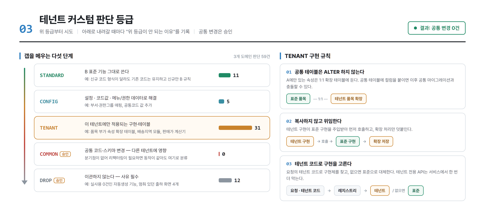

> **이 글의 핵심**: 해결 방법에 등급을 두고 "아래 등급으로 내려가려면 위 등급이 안 되는 이유를 적어라"는 규칙을 만들었다. 갭 59건을 판단하는 동안 다른 고객사에 영향을 주는 **공통 코드 변경은 0건**이었다.
{: .prompt-info }

- (1) [다른 서비스를 SaaS 테넌트로 옮기는 5단계 워크플로](/posts/service-migration-workflow/)
- (2) [테이블 이름이 아니라 업무 흐름으로 갭 찾기](/posts/service-migration-gap-analysis/)
- (3) 공통 코드를 건드리지 않는 테넌트 커스텀 등급 ← 이 글
- (4) [구조가 다른 데이터 모델 매핑과 리허설](/posts/service-migration-data-mapping/)
- (5) [앞 단계가 틀렸다고 가정하고 검증하기](/posts/service-migration-verification/)

이 글은 5단계 중 **2단계, 테넌트 커스텀 설계**다. [(2)편](/posts/service-migration-gap-analysis/)에서 찾은 갭을 어떻게 메울지 정한다. 여기서 "테넌트"는 B 플랫폼을 쓰는 고객사 하나를 뜻한다.

## 가장 빠른 해결이 가장 위험하다

갭이 하나 나오면 가장 빨리 끝나는 방법은 B의 공통 코드를 고치는 것이다. 품목 테이블에 컬럼 몇 개를 추가하고, 표준 서비스에 if 문을 넣으면 된다. 에이전트에게 "갭을 메워 줘"라고만 하면 높은 확률로 이 길을 택한다.

하지만 B는 여러 고객사가 함께 쓰는 플랫폼이다. 공통 코드를 고치면 그 변경은 **모든 고객사에 배포**된다. 한 고객사를 옮기려다 다른 고객사의 동작을 바꿀 수 있다.

그래서 해결 방법에 **등급**을 두고, 위에서부터 시도하게 했다.

{: w="1600" h="720" }

## 다섯 등급

| 등급 | 해결 방법 | 내 승인 |
|---|---|---|
| `STANDARD` | B 표준 기능 그대로 쓴다 | — |
| `CONFIG` | 설정, 코드값, 메뉴·권한 데이터로 해결한다 | — |
| `TENANT` | 이 고객사에만 적용되는 전용 구현을 붙인다 | — |
| `COMMON` | 공통 코드·스키마를 바꾼다 (다른 고객사 영향) | **필수** |
| `DROP` | 옮기지 않는다 (사유 필수) | **필수** |

핵심 규칙은 하나다. **아래 등급으로 내려갈 때마다 위 등급이 안 되는 이유를 적는다.** 결정표에 "위 등급 불가 사유" 칸을 따로 두었다.

| 갭 | 등급 | 해결 방법 | 위 등급 불가 사유 |
|---|---|---|---|
| 카테고리 사용여부 수정 | TENANT | 표준 수정 후 전용 구현이 사용여부·정렬 갱신 | 설정으로는 수정 API 동작을 못 바꾼다 |
| 상품 부가 속성 | TENANT | 1:1 확장 테이블 + 전용 구현 | 표준 품목 테이블에 컬럼이 없고, 공통 테이블 변경은 금지 |
| 부서·권한 | CONFIG | 부서 2개, 권한그룹 매핑 데이터 | — 데이터만으로 가능 |

이 칸이 있으면 에이전트가 쉬운 길로 바로 내려가지 못한다. 나도 검토할 때 "정말 설정으로 안 되나?"를 칸 하나만 보고 판단할 수 있다.

### 등급별 실제 예

- **STANDARD — 차이를 받아들인다.** A와 B는 신규 거래처 코드 형식이 다르다. 기존 코드는 그대로 옮기고, 이관 후 새로 만드는 것만 B 규칙을 따르게 했다. 접두어가 달라 충돌도 없다.
- **CONFIG — 데이터로 해결한다.** A의 사원 권한(관리자·배송기사 등)은 B의 권한그룹·부서 데이터로 옮겼다. 코드 변경은 없다.
- **TENANT — 이 고객사에만 붙인다.** B에 개념 자체가 없는 배송지역은 전용 모듈로 설계했다. "거래처를 등록하면 상품그룹을 자동으로 만드는" A의 동작은, B에 이미 있던 "거래처 등록 후 처리" 확장 지점에 전용 구현을 하나 끼워 해결했다.
- **COMMON — 끼워 넣을 자리를 만드는 것도 COMMON이다.** 표준 구현이 인터페이스 뒤에 있지 않으면 전용 구현을 끼울 곳이 없다. 이때 표준 코드를 인터페이스로 빼는 리팩터링은 동작이 그대로여도 공통 코드 변경이므로 승인 대상으로 분류했다.
- **DROP — 사유와 승인이 필요하다.** 실사용 0건인 바코드 자동생성, 멈춰 있던 출하 화면 4개가 여기에 해당한다. 에이전트가 근거와 함께 제안하고 내가 승인했다.

### 결과: 공통 변경 0건

세 영역에서 내린 판단 59건이다.

| 등급 | 기준정보 | 주문 | 출하/배송 | 합계 |
|---|---|---|---|---|
| STANDARD | 6 | 3 | 2 | 11 |
| CONFIG | 3 | 1 | 1 | 5 |
| TENANT | 15 | 11 | 5 | 31 |
| COMMON | 0 | 0 | 0 | **0** |
| DROP | 2 | 3 | 7 | 12 |

공통 변경이 필요해 보이는 순간은 몇 번 있었다. 예를 들어 사원을 등록할 때 A에만 있는 "사원 구분"을 함께 저장하려면, 공통 등록 파라미터에 필드 하나를 추가하는 게 가장 간단했다. 대신 사원을 등록한 뒤 **전용 API로 확장 정보를 따로 저장**하게 설계해서 공통 변경을 피했다.

## 전용 구현(TENANT)도 규칙이 있다

전용 구현도 아무렇게나 만들면 나중에 공통 코드와 충돌한다. 그래서 **B에 이미 있는 패턴만** 쓰게 했다.

### 1. 공통 테이블은 ALTER 하지 않는다

A에만 있는 속성(과세 구분, 보관 방법, 중량 등)은 표준 테이블과 1:1로 붙는 **확장 테이블**에 둔다. 확장 테이블은 이 고객사 스키마에만 만들어지므로 다른 고객사에는 아예 생기지 않는다.

```text
표준 품목 테이블  ── 1:1 ──  품목 확장 테이블 (이 고객사 스키마에만 존재)
```

B에는 표준 품목 테이블에 직접 컬럼을 추가한 다른 고객사의 선례도 있었다. 에이전트는 이 선례를 발견했지만 따르지 않았다. 이후 공통 마이그레이션이 같은 테이블을 바꿀 때 충돌할 수 있다는 이유를 설계 문서에 남겼다.

### 2. 복사하지 않고 위임한다

표준 코드를 복사해서 고치지 않는다. 전용 구현이 표준 구현을 먼저 호출하고, 확장 처리만 덧붙인다.

```java
@TenantComponent(code = TenantCodes.XXX)
public class XxxItem implements IItem {

    private final StandardItem standard;
    private final XxxItemExtMapper extMapper;

    @Override
    public void insert(ItemSaveParam param) {
        standard.insert(param);          // 표준 동작 그대로
        extMapper.upsert(param.getExt()); // 이 고객사 확장 속성만 추가
    }
}
```

표준 구현이 바뀌어도 전용 구현은 그 변경을 자동으로 따라간다. 복사했다면 표준 쪽 버그 수정이 이 고객사에만 반영되지 않는 일이 생긴다.

### 3. 고객사 코드로 구현을 고른다

요청에 담긴 고객사 코드로 전용 구현을 찾고, 없으면 표준 구현을 쓴다. 이 구조는 [트랜잭션 단위로 스키마 설정](/posts/transaction-boundary-standardization/) 시리즈에서 다룬 테넌트 분리 구조 위에서 동작한다. 전용 API는 URL과 패키지를 따로 두고, 다른 고객사가 호출하면 예외가 나게 했다.

## 다른 고객사 영향을 역추적한다

변경마다 다른 고객사에 영향이 없다는 **근거**를 적게 했다.

- 바꾸는 인터페이스·매퍼·테이블을 어디서 쓰는가 → 전체 소스 검색
- 표준 및 다른 고객사 동작이 변하지 않는가 → 구현 선택 로직, 기존 전용 구현 확인
- 같은 인터페이스에 전용 구현이 중복 등록되지 않는가 → 중복 등록 예외 조건 확인
- 이후 공통 마이그레이션과 충돌하지 않는가 → 공통 마이그레이션 이력 패턴 확인

마지막 항목에서 운영상 주의점 두 가지가 나왔다.

- 공통 마이그레이션은 새 메뉴를 추가할 때 **기존 권한그룹 전체에 자동 부여**한다. 이관한 고객사의 배송기사 권한에도 관리 메뉴가 붙을 수 있다.
- 전용 메뉴 ID가 나중에 공통 메뉴 ID와 겹치면 공통 마이그레이션이 덮어쓸 수 있다.

둘 다 당장 문제는 아니라서 코드를 바꾸지 않고 **운영 체크리스트**에 올렸다.

## A의 버그는 옮기지 않는다

분석 중 A의 버그성 동작도 여러 개 나왔다. 확정 시 배송기사가 비는 문제, 재배차 시 상태가 초기화되는 문제, 중복 검사를 화면에서만 해서 실제로 중복 주문이 쌓인 문제 등이다.

"흐름의 기준은 A"라는 원칙이 있지만 버그까지 재현하지는 않았다. 따로 모아 확인받고, B에서는 고친 동작으로 설계했다. 예를 들어 중복 검사는 **서버가 검사**하도록 바꿨다.

## 사례: 고객 주문앱을 어디에 붙일까

가장 큰 결정은 고객사의 거래처들이 쓰는 **주문앱**이었다. 실측해 보니 최근 주문의 대부분이 이 앱으로 들어오고 있었다. 그런데 B에는 고객이 로그인하는 개념 자체가 없다.

에이전트가 선택지를 정리해 올렸다.

1. A 서버를 앱 전용으로 남긴다
2. B에 고객 포털을 새로 만든다
3. B에 A와 **똑같은 API**를 전용 모듈로 만든다

나는 3번을 골랐다. 목표가 "A 서버를 내리는 것"이므로 1번은 목표와 맞지 않고, 2번은 앱까지 다시 만들어야 한다. 3번은 A의 경로, 요청, 응답, 결과 코드를 그대로 유지하므로 **앱은 접속 주소만 바꾸면 된다.** 이 결정으로 컷오버를 막고 있던 문제 하나가 풀렸다.

## 정리

- 해결 방법을 `STANDARD → CONFIG → TENANT → COMMON → DROP` 등급으로 나누고 **위에서부터** 시도했다.
- 아래로 내려갈 때마다 **위 등급이 안 되는 이유**를 적게 해서, 에이전트가 쉬운 길로 바로 내려가지 못하게 했다.
- 전용 구현은 확장 테이블, 위임, 고객사 코드 기반 선택이라는 **기존 패턴만** 썼다.
- 변경마다 다른 고객사 영향을 역추적했고, 59건 중 **공통 변경은 0건**이었다.

다음 글에서는 이 설계를 바탕으로 구조가 다른 데이터를 실제로 매핑하고, 다시 돌려도 같은 결과가 나오는 스크립트로 리허설한 과정을 다룬다.
